# Sistema de Gestión de Biblioteca — AcaBiblioteca

## Portada

**CORPORACIÓN UNIFICADA NACIONAL DE EDUCACIÓN SUPERIOR (CUN)**

**Programa:** Ingeniería de Sistemas  
**Asignatura:** Programación Avanzada  
**Grupo:** 54465  
**Trabajo:** Actividad de Construcción Aplicada (ACA) — Sistema de Gestión de Biblioteca  
**Estudiante:** César Augusto Albino Vargas  
**Docente:** Verónica Castro  
**Año:** 2026

---

## Tabla de contenido

1. [Introducción](#1-introducción)
2. [Objetivos](#2-objetivos)
3. [Planteamiento del problema y alcance](#3-planteamiento-del-problema-y-alcance)
4. [Análisis de requerimientos](#4-análisis-de-requerimientos)
5. [Casos de uso](#5-casos-de-uso)
6. [Diseño de clases](#6-diseño-de-clases)
7. [Modelo de datos](#7-modelo-de-datos)
8. [Diccionario de datos](#8-diccionario-de-datos)
9. [Arquitectura e implementación](#9-arquitectura-e-implementación)
10. [Módulos desarrollados](#10-módulos-desarrollados)
11. [Evidencias visuales](#11-evidencias-visuales)
12. [Pruebas funcionales](#12-pruebas-funcionales)
13. [Conclusiones](#13-conclusiones)
14. [Recomendaciones](#14-recomendaciones)
15. [Referencias y anexos](#15-referencias-y-anexos)

---

## 1. Introducción

AcaBiblioteca es una aplicación de escritorio académica para administrar información básica de una biblioteca. Se desarrolló en C# mediante Windows Forms, utilizando Visual Studio 2026 y SQL Server LocalDB como sistema de almacenamiento. La interfaz permite gestionar libros, autores, editoriales y usuarios mediante operaciones de creación, consulta, actualización y eliminación (CRUD). También incluye registro y devolución de préstamos, actualización de existencias y consultas de reportes.

El proyecto integra formularios gráficos, programación orientada a objetos, eventos, validaciones, consultas SQL parametrizadas y conexión a una base de datos relacional. Su documentación se limita a las funciones desarrolladas y a los resultados efectivamente observados.

## 2. Objetivos

### 2.1 Objetivo general

Desarrollar una aplicación de escritorio para la gestión básica de una biblioteca mediante C#, Windows Forms y SQL Server LocalDB, aplicando operaciones CRUD y conceptos de programación avanzada.

### 2.2 Objetivos específicos

- Construir una interfaz principal para navegar entre los formularios.
- Implementar la gestión de libros, autores, editoriales y usuarios.
- Permitir la búsqueda de libros mediante ISBN.
- Relacionar libros con autores y editoriales existentes.
- Validar datos obligatorios y presentar mensajes al usuario.
- Centralizar la creación de conexiones a la base de datos.
- Registrar préstamos y devoluciones, manteniendo las existencias de libros.
- Generar consultas de préstamos activos, préstamos devueltos e inventario de libros.
- Comprobar el funcionamiento mediante pruebas manuales.
- Gestionar versiones del código con Git y GitHub.

## 3. Planteamiento del problema y alcance

### 3.1 Problema

La administración de registros bibliográficos y de circulación de libros requiere organizar información, mantener las existencias actualizadas y facilitar las consultas. La interacción directa con tablas SQL no constituye una interfaz adecuada para el usuario general. El proyecto propone un sistema académico de escritorio que centraliza esas operaciones.

### 3.2 Justificación

El desarrollo permite aplicar interfaces gráficas, programación orientada a objetos, manejo de eventos, persistencia relacional, consultas parametrizadas, validaciones y control de errores.

### 3.3 Alcance implementado

- **Libros:** registro, consulta, búsqueda por ISBN, edición y eliminación, con selección de autor y editorial.
- **Autores, editoriales y usuarios:** formularios de consulta y mantenimiento CRUD.
- **Préstamos:** selección de usuario y libro, registro de préstamo, consulta, edición y eliminación; manejo de fecha de devolución opcional y estado del préstamo.
- **Devoluciones:** actualización de un préstamo a estado `Devuelto` y restitución de existencias del libro; se comprobó mediante SQL en una prueba.
- **Reportes:** préstamos activos, préstamos devueltos e inventario de libros; generación y limpieza de resultados.
- **Navegación:** menú principal y apertura de formularios en el panel central.

El sistema es un prototipo. No incluye autenticación, reservas, multas ni exportación de reportes.

## 4. Análisis de requerimientos

### 4.1 Actor

**Operador de la biblioteca:** utiliza el menú y los formularios para administrar registros, préstamos y consultas. No se implementaron cuentas de acceso ni permisos diferenciados.

### 4.2 Requerimientos funcionales

| Código | Requerimiento | Descripción |
|---|---|---|
| RF01 | Gestionar libros | Registrar, consultar, buscar por ISBN, editar y eliminar libros. |
| RF02 | Gestionar autores | Registrar, consultar, editar y eliminar autores. |
| RF03 | Gestionar editoriales | Registrar, consultar, editar y eliminar editoriales. |
| RF04 | Gestionar usuarios | Registrar, consultar, editar y eliminar usuarios. |
| RF05 | Registrar préstamos | Asociar un usuario con un libro y registrar la fecha del préstamo. |
| RF06 | Gestionar devoluciones | Registrar fecha de devolución, estado `Devuelto` y actualizar existencias. |
| RF07 | Consultar préstamos | Visualizar préstamos y sus estados en una tabla. |
| RF08 | Generar reportes | Consultar préstamos activos, préstamos devueltos e inventario. |
| RF09 | Validar información | Comprobar campos requeridos y fechas según las reglas implementadas. |
| RF10 | Navegar | Acceder a los formularios desde el menú principal. |
| RF11 | Mantener relaciones | Relacionar libros con autores/editoriales y préstamos con usuarios/libros. |
| RF12 | Persistir datos | Ejecutar consultas y modificaciones en SQL Server LocalDB. |

### 4.3 Requerimientos no funcionales

| Código | Requerimiento | Descripción |
|---|---|---|
| RNF01 | Plataforma | Aplicación de escritorio para Windows. |
| RNF02 | Tecnologías | C#, Windows Forms y Visual Studio 2026. |
| RNF03 | Almacenamiento | SQL Server LocalDB. |
| RNF04 | Acceso a datos | `Microsoft.Data.SqlClient` y clase `Conexion`. |
| RNF05 | Usabilidad | Etiquetas, botones, listas desplegables y `DataGridView`. |
| RNF06 | Integridad | Claves primarias, foráneas y restricciones relacionales. |
| RNF07 | Consultas seguras | Uso de parámetros SQL para valores ingresados. |
| RNF08 | Control de versiones | Git, GitHub y GitHub Desktop. |

### 4.4 Reglas de negocio observadas

- El ISBN identifica cada libro.
- Los libros se asocian con autores y editoriales.
- Un préstamo se vincula con un usuario y un ISBN.
- La fecha de devolución admite `NULL` para préstamos activos.
- Los estados utilizados son `Prestado` y `Devuelto`.
- Se comprobó que registrar un préstamo reduce las existencias y registrar su devolución las restituye.
- Las operaciones CRUD utilizan los controles y validaciones del formulario.

### 4.5 Diagrama de referencia

    

*Figura 1. Análisis de requerimientos suministrado por la profesora como material de apoyo.*

**Aclaración:** la figura describe una propuesta más amplia e incluye categorías independientes, multas y otros requisitos no implementados. La tabla de requerimientos anterior corresponde al alcance real de AcaBiblioteca.

## 5. Casos de uso

### 5.1 Diagrama de referencia

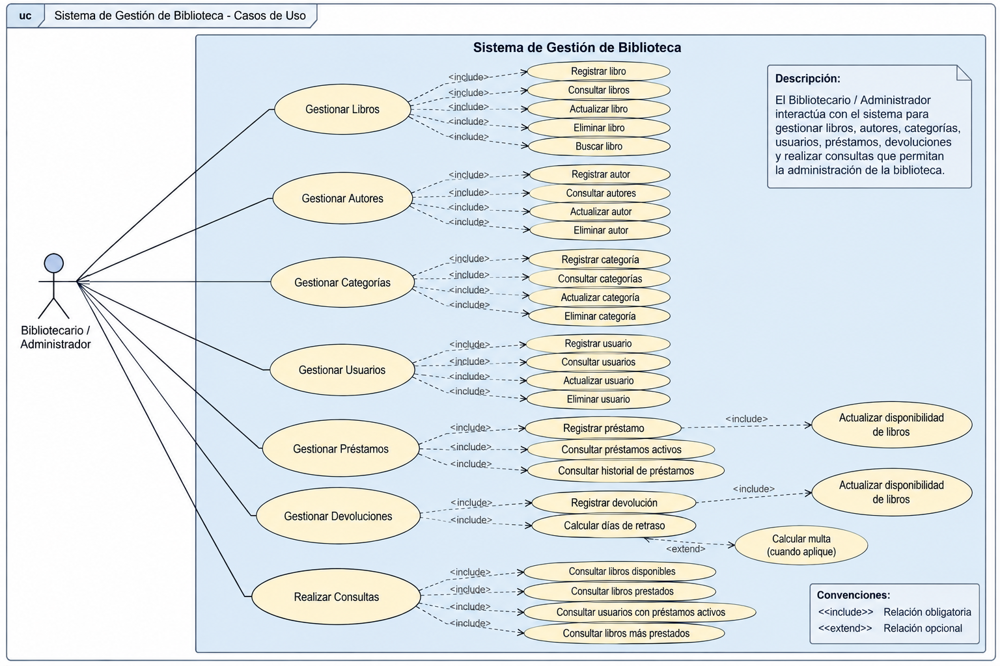

*Figura 2. Diagrama de casos de uso.*

**Alcance:** los casos de multas, cálculo de retrasos, categorías independientes y otros procesos de la figura no se atribuyen a la aplicación implementada.

### 5.2 Casos de uso del sistema desarrollado

| Código | Caso de uso | Resultado esperado |
|---|---|---|
| CU01 | Registrar libro | Libro almacenado y visible en el listado. |
| CU02 | Buscar libro por ISBN | Se muestra el libro correspondiente. |
| CU03 | Editar o eliminar libro | Se modifica o elimina si las restricciones lo permiten. |
| CU04 | Gestionar autores | Se realizan operaciones de mantenimiento. |
| CU05 | Gestionar editoriales | Se realizan operaciones de mantenimiento. |
| CU06 | Gestionar usuarios | Se realizan operaciones de mantenimiento. |
| CU07 | Registrar préstamo | Se crea el préstamo y se actualizan existencias. |
| CU08 | Registrar devolución | El préstamo queda `Devuelto` y se restituye una existencia. |
| CU09 | Consultar préstamos activos | Se muestran préstamos con estado `Prestado`. |
| CU10 | Consultar préstamos devueltos | Se muestran préstamos con estado `Devuelto`. |
| CU11 | Consultar inventario | Se muestran libros, autores, editoriales y existencias. |
| CU12 | Limpiar reporte | Se vacía la consulta visualizada. |

### 5.3 Flujo resumido de préstamo y devolución

1. El operador abre **Préstamos** y selecciona un usuario y un libro.
2. Indica la fecha del préstamo y deja sin marcar la fecha de devolución cuando el libro se entrega al usuario.
3. Presiona **Guardar**; la aplicación registra el préstamo y descuenta una existencia.
4. Al devolver el libro, selecciona el préstamo, marca la fecha de devolución y presiona **Editar**.
5. La aplicación actualiza el estado a `Devuelto` y restituye la existencia; este resultado se verificó en la base de datos.

## 6. Diseño de clases

### 6.1 Diagrama de referencia 

*Figura 3. Diagrama de clases suministrado por la profesora como guía académica.*

**Diferencias:** la figura incluye clases `Categoria`, `DetallePrestamo` y `Devolucion`, así como métodos para multas. Esas clases no forman parte de la implementación actual, que trabaja con cinco tablas y formularios Windows Forms.

### 6.2 Clases principales implementadas

| Clase | Responsabilidad |
|---|---|
| `FrmPrincipal` | Menú principal y apertura de formularios en `PnlContenido`. |
| `FrmInicio` | Pantalla inicial. |
| `FrmLibros` | CRUD de libros y búsqueda por ISBN. |
| `FrmAutores` | CRUD de autores. |
| `FrmEditoriales` | CRUD de editoriales. |
| `FrmUsuarios` | CRUD de usuarios. |
| `FrmPrestamos` | Registro, edición, eliminación y consulta de préstamos y devoluciones. |
| `FrmReportes` | Consultas de préstamos activos, devueltos e inventario. |
| `Conexion` | Obtención de conexión SQL mediante `obtenerConexion()`. |

### 6.3 Dependencias de la implementación

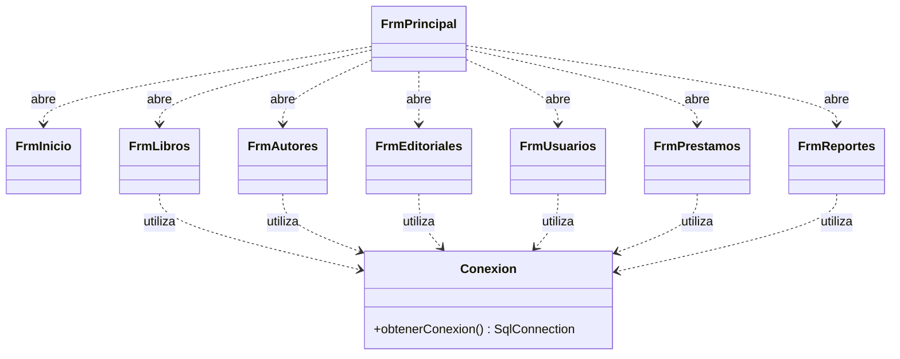

## 7. Modelo de datos

### 7.1 Base de datos implementada

La base de datos `AcaBiblioteca` en SQL Server LocalDB contiene cinco tablas: `Autores`, `Editoriales`, `Libros`, `Usuarios` y `Prestamos`. La categoría se almacena en el campo `Categoria` de `Libros`. La devolución se registra en `Prestamos` mediante fecha y estado, sin tabla independiente.

### 7.2 Diagrama entidad-relación de la implementación

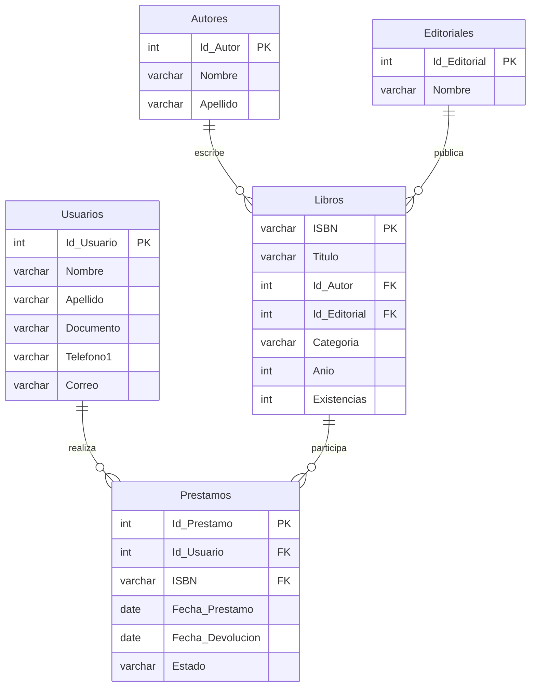

**Nota:** las relaciones representan el diseño relacional utilizado en el sistema. La verificación final de nombres, longitudes y restricciones debe realizarse contra el script SQL entregado.

## 8. Diccionario de datos

### 8.1 Diccionario de referencia

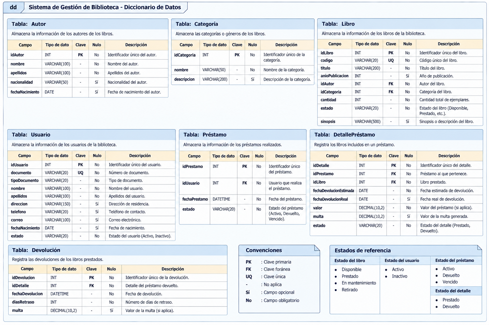

*Figura 4. Diccionario de datos proporcionado por la profesora Veronica Castro.*

**Aclaración:** contiene siete entidades y campos diferentes a mi base de datos; no representa el esquema implementado. El siguiente diccionario sí utiliza los nombres de las cinco tablas reales.

### 8.2 Tabla `Autores`

| Campo | Descripción |
|---|---|
| `Id_Autor` | Identificador principal del autor. |
| `Nombre` | Nombre. |
| `Apellido` | Apellido. |

### 8.3 Tabla `Editoriales`

| Campo | Descripción |
|---|---|
| `Id_Editorial` | Identificador principal de la editorial. |
| `Nombre` | Nombre de la editorial. |

### 8.4 Tabla `Libros`

| Campo | Descripción |
|---|---|
| `ISBN` | Identificador del libro. |
| `Titulo` | Título. |
| `Id_Autor` | Referencia al autor. |
| `Id_Editorial` | Referencia a la editorial. |
| `Categoria` | Categoría o género. |
| `Anio` | Año de publicación registrado. |
| `Existencias` | Cantidad de ejemplares disponibles. |

### 8.5 Tabla `Usuarios`

| Campo | Descripción |
|---|---|
| `Id_Usuario` | Identificador principal. |
| `Nombre` | Nombre. |
| `Apellido` | Apellido. |
| `Documento` | Documento de identificación. |
| `Telefono1` | Teléfono; el formulario puede mostrarlo con alias `Telefono`. |
| `Correo` | Correo electrónico. |

### 8.6 Tabla `Prestamos`

| Campo | Tipo SQL | Permite `NULL` | Descripción |
|---|---|---|---|
| `Id_Prestamo` | `int` | No | Identificador del préstamo. |
| `Id_Usuario` | `int` | No | Usuario asociado. |
| `ISBN` | `varchar` | No | Libro prestado. |
| `Fecha_Prestamo` | `date` | No | Fecha del préstamo. |
| `Fecha_Devolucion` | `date` | Sí | Fecha de devolución, opcional mientras está prestado. |
| `Estado` | `varchar` | No | Estado del préstamo (`Prestado` o `Devuelto`). |

Los tipos y la nulabilidad de `Prestamos` se comprobaron mediante una consulta al esquema SQL compartida durante el desarrollo. 

## 9. Arquitectura e implementación

### 9.1 Arquitectura de referencia

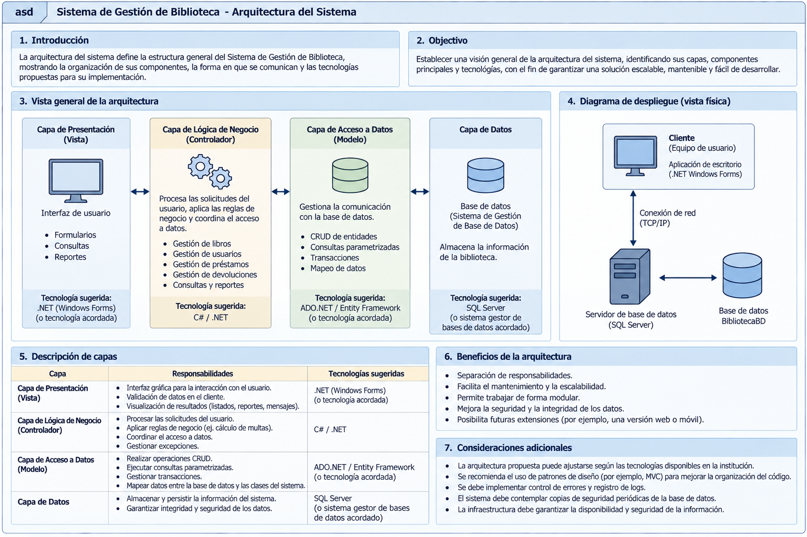

*Figura 5. Arquitectura general suministrada por la profesora Veronica Castro.*

La imagen describe una organización por capas propuesta para un sistema de biblioteca. **No debe interpretarse como prueba de que el proyecto implementa controladores, repositorios o un servidor remoto de base de datos.**

### 9.2 Arquitectura utilizada en AcaBiblioteca

La aplicación utiliza formularios Windows Forms que manejan eventos y ejecutan consultas SQL parametrizadas. La clase `Conexion`, ubicada en el proyecto, centraliza la creación de conexiones mediante `obtenerConexion()`. El almacenamiento utiliza SQL Server LocalDB.

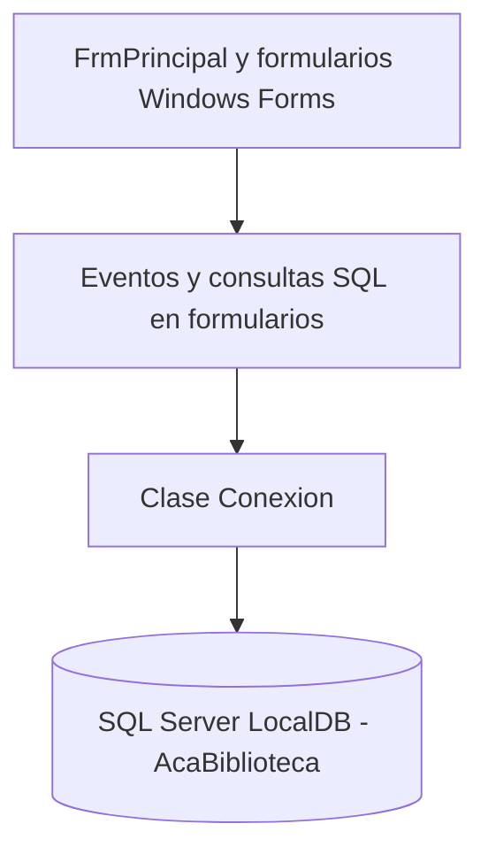

No se presenta como arquitectura estricta de tres capas, porque parte de la lógica de negocio y del acceso a datos se encuentra en los formularios.

### 9.3 Herramientas

- Visual Studio 2026, C# y Windows Forms.
- SQL Server LocalDB y `Microsoft.Data.SqlClient`.
- Visual Studio Code para editar Markdown.
- Git, GitHub y GitHub Desktop para versionamiento.

### 9.4 Control de versiones

El proyecto se mantiene en un repositorio GitHub y se sincroniza entre computadores mediante **Commit**, **Push**, **Fetch** y **Pull** en GitHub Desktop.

## 10. Módulos desarrollados

### 10.1 Libros — `FrmLibros`

Formulario con ISBN, título, autor, editorial, categoría, año y existencias. Permite consulta, búsqueda por ISBN y operaciones CRUD. Los autores y editoriales se seleccionan desde listas desplegables.

### 10.2 Autores — `FrmAutores`

Formulario para consultar, registrar, editar y eliminar autores mediante Nombre, Apellido y tabla `DataGridView`.

### 10.3 Editoriales — `FrmEditoriales`

Formulario de consulta y mantenimiento de editoriales. Su listado fue observado en ejecución con datos provenientes de la base de datos.

### 10.4 Usuarios — `FrmUsuarios`

Formulario CRUD de usuarios con nombre, apellido, documento, teléfono y correo. La columna `Telefono1` se presenta como `Telefono` mediante alias en la consulta del formulario.

### 10.5 Préstamos y devoluciones — `FrmPrestamos`

Incluye listas desplegables de usuario y libro, fecha de préstamo y fecha de devolución opcional, botones Nuevo, Guardar, Editar, Eliminar y Cancelar, y una tabla con identificador, usuario, ISBN, fechas y estado. Se probó el registro de un préstamo y su posterior devolución, verificando los cambios en `Prestamos` y en las existencias del libro.

### 10.6 Reportes — `FrmReportes`

Permite seleccionar el tipo de reporte, **Generar** resultados y **Limpiar** la tabla. Se visualizaron correctamente tres consultas:

1. **Préstamos activos:** registros en estado `Prestado`, con nombre del usuario y título del libro.
2. **Préstamos devueltos:** registros en estado `Devuelto`, con fechas y datos asociados.
3. **Inventario de libros:** ISBN, título, autor, editorial, categoría, año y existencias.

### 10.7 Menú principal — `FrmPrincipal`

Presenta las opciones Inicio, Libros, Usuarios, Autores, Editoriales, Préstamos, Reportes y Salir; los formularios se abren dentro del panel central.

## 11. Evidencias visuales

Las siguientes capturas corresponden a las pruebas funcionales realizadas en AcaBiblioteca mediante Visual Studio y SQL Server LocalDB. Se presentan como evidencia del funcionamiento de los módulos implementados.

### 11.1 Gestión de usuarios
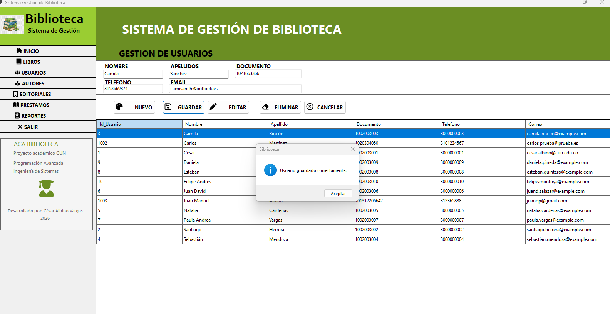

*Figura 6. Registro de usuario realizado correctamente.*

### 11.2 Gestión de autores
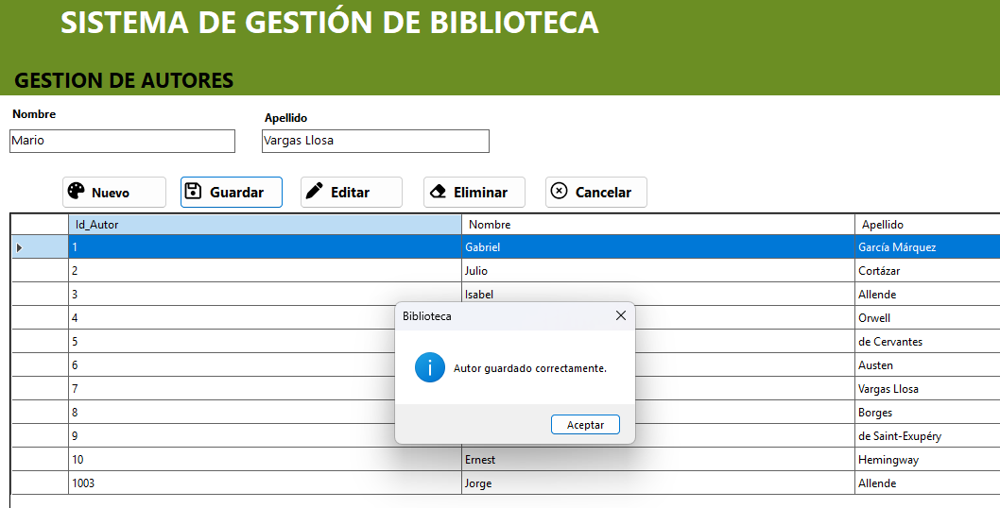

*Figura 7. Registro de autor realizado correctamente.*

### 11.3 Gestión de editoriales
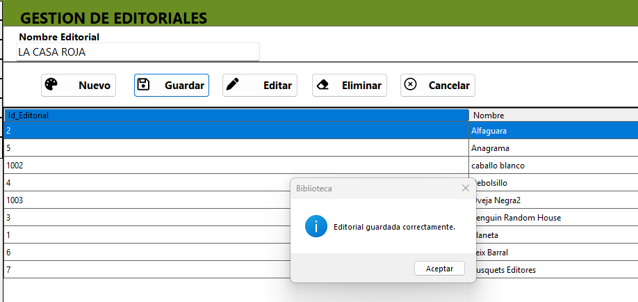

*Figura 8. Registro de editorial realizado correctamente.*

### 11.4 Registro de préstamos
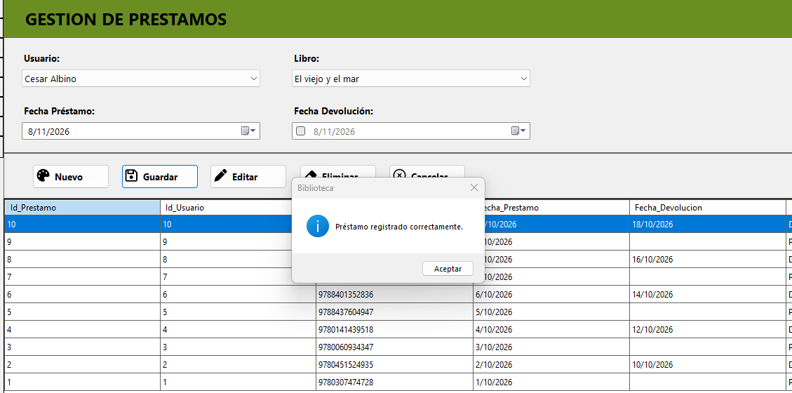

*Figura 9. Confirmación del registro de un préstamo.*

### 11.5 Actualización de préstamos y devoluciones
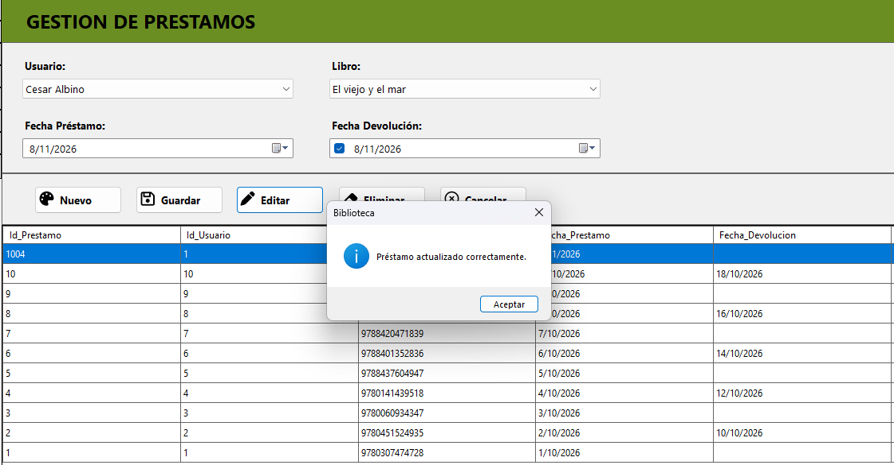

*Figura 10. Confirmación de actualización de un préstamo desde el formulario.*

### 11.6 Búsqueda de libros por ISBN
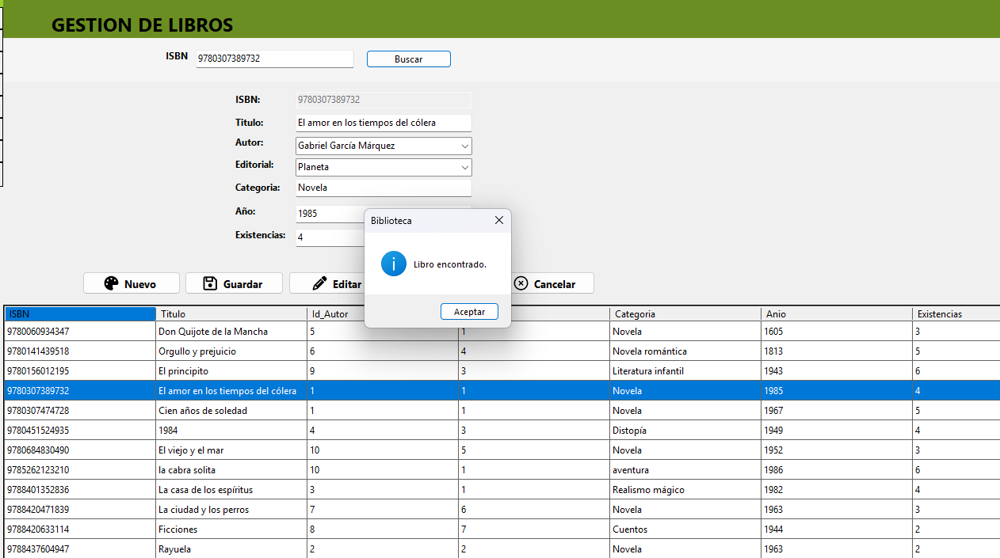

*Figura 11. Consulta exitosa de un libro mediante su código ISBN.*

### 11.7 Reporte de inventario
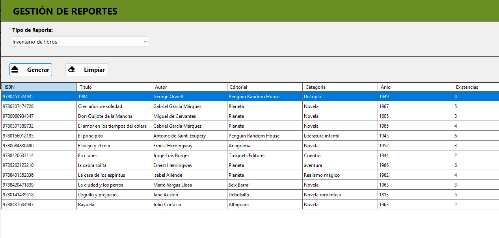

*Figura 12. Reporte de inventario con información bibliográfica y existencias.*

### 11.8 Eliminación de libros
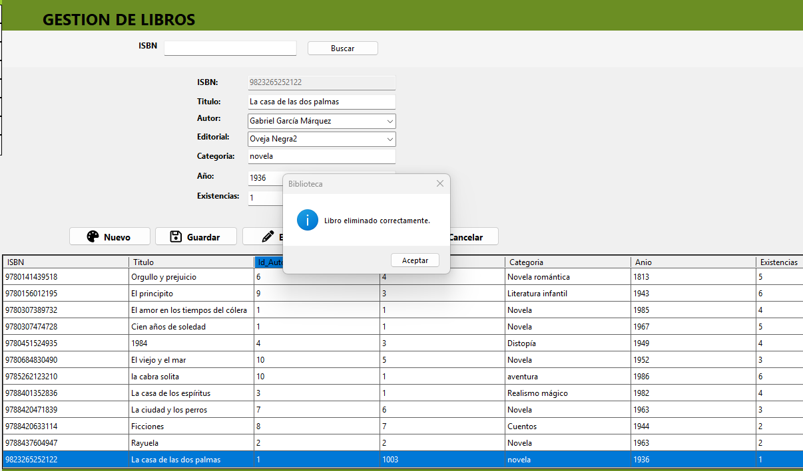

*Figura 13. Confirmación de eliminación de un libro.*

### 11.9 Verificación de información en SQL Server
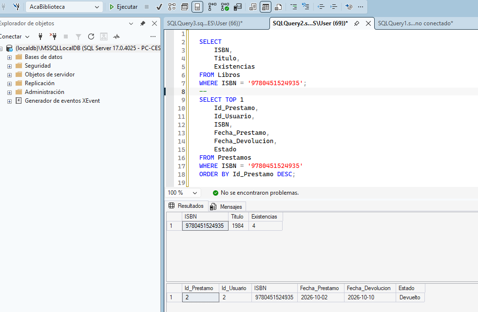

*Figura 14. Consulta SQL de existencias de un libro y registro de préstamo devuelto.*

Esta evidencia permite contrastar la información presentada en los formularios con los registros almacenados en la base de datos.

## 12. Pruebas funcionales

### 12.1 Objetivo de las pruebas

Verificar el correcto funcionamiento de los módulos desarrollados en AcaBiblioteca, comprobando las operaciones de registro, consulta, actualización y eliminación de información, así como la gestión de préstamos, devoluciones y generación de reportes.

### 12.2 Entorno de pruebas

- Aplicación: AcaBiblioteca.
- Lenguaje: C#.
- Interfaz gráfica: Windows Forms.
- Entorno de desarrollo: Visual Studio.
- Motor de base de datos: SQL Server LocalDB.
- Base de datos: AcaBiblioteca.
- Tipo de pruebas: funcionales y manuales.

### 12.3 Resultados de las pruebas

| Código | Módulo | Prueba realizada | Resultado |
|---|---|---|---|
| PF01 | Usuarios | Registrar un usuario | Satisfactorio |
| PF02 | Usuarios | Consultar, editar y eliminar usuarios | Satisfactorio |
| PF03 | Autores | Registrar un autor | Satisfactorio |
| PF04 | Autores | Consultar, editar y eliminar autores | Satisfactorio |
| PF05 | Editoriales | Registrar una editorial | Satisfactorio |
| PF06 | Editoriales | Consultar, editar y eliminar editoriales | Satisfactorio |
| PF07 | Libros | Buscar un libro mediante ISBN | Satisfactorio |
| PF08 | Libros | Registrar y actualizar libros | Satisfactorio |
| PF09 | Libros | Eliminar un libro | Satisfactorio |
| PF10 | Préstamos | Registrar un préstamo | Satisfactorio |
| PF11 | Préstamos | Registrar una devolución | Satisfactorio |
| PF12 | Préstamos | Consultar, editar y eliminar préstamos | Satisfactorio |
| PF13 | Reportes | Generar inventario de libros | Satisfactorio |
| PF14 | Reportes | Generar reporte de préstamos activos | Satisfactorio |
| PF15 | Reportes | Generar reporte de préstamos devueltos | Satisfactorio |
| PF16 | Base de datos | Consultar registros mediante SQL | Satisfactorio |

### 12.4 Validación de reglas de negocio

Durante las pruebas funcionales se verificó el comportamiento de las principales reglas implementadas:

- Los libros se relacionan con autores y editoriales.
- Los préstamos se asocian con usuarios y libros mediante sus identificadores.
- El registro de un préstamo disminuye las existencias disponibles del libro.
- El registro de una devolución restituye las existencias correspondientes.
- Los préstamos permiten identificar su estado como Prestado o Devuelto.
- Las operaciones de los formularios presentan mensajes de confirmación y validaciones.

### 12.5 Evidencias de las pruebas

Las capturas incorporadas en la sección 11 documentan operaciones de registro de usuarios, autores y editoriales; búsqueda y eliminación de libros; registro y actualización de préstamos; generación de reportes y consulta de información en SQL Server.

Las pruebas restantes fueron verificadas manualmente durante la ejecución de la aplicación.

### 12.6 Conclusión de las pruebas

De acuerdo con las pruebas funcionales realizadas, los módulos implementados en AcaBiblioteca presentaron un funcionamiento satisfactorio en el entorno de desarrollo.

Se verificaron las operaciones principales de gestión bibliográfica, administración de usuarios, control de préstamos y devoluciones, generación de reportes y consulta de información almacenada en la base de datos.

Los resultados permiten concluir que la aplicación cumple con las funcionalidades definidas para el alcance académico del proyecto.

## 13. Conclusiones

El desarrollo de AcaBiblioteca permitió aplicar los conocimientos adquiridos en la asignatura Programación Avanzada mediante la construcción de una aplicación de escritorio orientada a la gestión de una biblioteca.

La implementación se realizó utilizando C#, Windows Forms y SQL Server LocalDB, integrando una interfaz gráfica con una base de datos relacional para administrar libros, autores, editoriales, usuarios y préstamos.

Durante el desarrollo se implementaron operaciones CRUD (crear, consultar, actualizar y eliminar), así como funcionalidades de búsqueda de libros por ISBN, registro de préstamos, control de devoluciones y generación de reportes.

La integración entre los formularios y la base de datos permitió comprobar la importancia de mantener la consistencia de la información. En particular, la gestión de préstamos y devoluciones permitió aplicar reglas de negocio relacionadas con el control de existencias y el estado de los libros prestados.

Las pruebas funcionales realizadas permitieron verificar el comportamiento de los módulos implementados y confirmar su funcionamiento satisfactorio dentro del entorno de desarrollo. Los resultados fueron documentados mediante capturas de pantalla y consultas SQL.

Asimismo, el proyecto fortaleció competencias relacionadas con la programación orientada a objetos, el manejo de eventos, la validación de datos, las consultas SQL, la depuración de errores y el control de versiones mediante Git y GitHub.

En conclusión, AcaBiblioteca cumple con los objetivos establecidos para el alcance académico del proyecto y constituye una aplicación funcional que integra conocimientos de programación, diseño de interfaces y gestión de bases de datos.

## 14. Recomendaciones

A partir del desarrollo y las pruebas funcionales realizadas en AcaBiblioteca, se identifican las siguientes recomendaciones para una posible evolución del sistema:

### 14.1 Mejorar las validaciones de información

Ampliar las validaciones de los formularios para controlar formatos de correo electrónico, números de documento, campos numéricos y registros duplicados, fortaleciendo la calidad de la información almacenada.

### 14.2 Implementar autenticación y roles de usuario

Incorporar un módulo de inicio de sesión que permita identificar a los usuarios del sistema y establecer permisos según sus responsabilidades, por ejemplo, administrador y encargado de biblioteca.

### 14.3 Fortalecer la gestión de préstamos

Agregar funcionalidades para consultar préstamos próximos a vencer, identificar devoluciones pendientes y generar alertas que faciliten el seguimiento de los libros prestados.

### 14.4 Ampliar las opciones de reportes

Incorporar filtros por fechas, usuarios y categorías, así como opciones para exportar los resultados a formatos como PDF o Excel.

### 14.5 Mejorar la presentación y usabilidad

Continuar perfeccionando la interfaz gráfica mediante ajustes de distribución, mensajes de validación, iconografía y adaptación de los formularios a diferentes resoluciones de pantalla.

### 14.6 Fortalecer la seguridad y el respaldo de datos

Establecer procedimientos de copia de seguridad y recuperación de la base de datos, además de mejorar el manejo de errores y la protección de la información registrada.

### 14.7 Facilitar la instalación del sistema

Desarrollar un procedimiento de instalación y configuración que permita ejecutar AcaBiblioteca en otros computadores, incluyendo los requisitos de conexión con SQL Server y la creación de la base de datos.

### 14.8 Continuar utilizando control de versiones

Mantener actualizado el repositorio GitHub, registrando los cambios mediante commits descriptivos y conservando la documentación técnica, el código fuente y los scripts de base de datos.

Estas recomendaciones representan oportunidades de mejora para futuras versiones de AcaBiblioteca y no constituyen requisitos pendientes del alcance académico desarrollado.

## 15. Referencias y anexos

### 15.1 Referencias técnicas y académicas

Para el desarrollo del proyecto AcaBiblioteca se utilizaron los conocimientos adquiridos durante la asignatura Programación Avanzada de la Corporación Unificada Nacional de Educación Superior (CUN), así como el material académico proporcionado por la docente.

Se utilizaron como referencias de consulta las siguientes fuentes:

- Corporación Unificada Nacional de Educación Superior (CUN). (2026). *Material de estudio de Programación Avanzada* [Material académico del curso].
- Microsoft. (s. f.). *Windows Forms*. Microsoft Learn. https://learn.microsoft.com/es-es/dotnet/desktop/winforms/
- Microsoft. (s. f.). *Documentación de C#*. Microsoft Learn. https://learn.microsoft.com/es-es/dotnet/csharp/
- Microsoft. (s. f.). *Documentación de SQL Server*. Microsoft Learn. https://learn.microsoft.com/es-es/sql/
- GitHub. (s. f.). *Documentación de GitHub*. https://docs.github.com/es

Las referencias técnicas se incluyen como recursos relacionados con las tecnologías utilizadas en el proyecto. Los diagramas académicos proporcionados por la docente se identifican como material de referencia y se diferencian de las funcionalidades efectivamente implementadas.

### 15.2 Repositorio del proyecto

El código fuente y la documentación de AcaBiblioteca se administran mediante Git y GitHub.

**Nombre del repositorio:** AcaBiblioteca

**Enlace:** https://github.com/cesaralbino-hub/AcaBiblioteca

El repositorio contiene el proyecto desarrollado en C# y Windows Forms, junto con los archivos de documentación y los recursos incorporados al control de versiones.

### 15.3 Anexos del proyecto

Los anexos corresponden a los archivos de apoyo necesarios para consultar la documentación y verificar la implementación.

**Anexo A. Código fuente**

Solución de Visual Studio que contiene los formularios, clases y demás componentes de AcaBiblioteca.

**Anexo B. Base de datos**

La carpeta `BD/` contiene los siguientes archivos:

- `creacion_tablas.sql`: script SQL para la creación de
  las cinco tablas de AcaBiblioteca y sus relaciones.
- `AcaBiblioteca.bak`: archivo de respaldo de la base
  de datos SQL Server.

El script permite crear la estructura de las tablas
sobre una base de datos previamente creada. El archivo
BAK se incluye como respaldo para su restauración
en un entorno compatible con SQL Server.

**Anexo C. Diagramas y material académico**

Carpeta `Imagenes/`, que contiene los diagramas de referencia utilizados en la documentación:

- Análisis de requerimientos.
- Diagrama de casos de uso.
- Diagrama de clases.
- Diccionario de datos.
- Arquitectura del sistema.

**Anexo D. Evidencias funcionales**

Carpeta `Evidencias/`, que contiene las capturas de pantalla correspondientes a las pruebas funcionales de los módulos desarrollados y las consultas realizadas en SQL Server.

**Anexo E. Documentación del proyecto**

Archivo `Documentacion.md`, que presenta los objetivos, requerimientos, diseño, implementación, pruebas, conclusiones y recomendaciones del sistema.

### 15.4 Consideraciones para la ejecución

AcaBiblioteca fue desarrollada como una aplicación de escritorio utilizando C# y Windows Forms, con conexión a SQL Server LocalDB.

Para ejecutar el sistema en otro computador se requiere disponer del entorno de ejecución de .NET compatible con el proyecto, una instancia de SQL Server LocalDB y la base de datos AcaBiblioteca correctamente configurada.

La configuración de conexión debe corresponder a la instancia de SQL Server disponible en el equipo donde se ejecute la aplicación.

