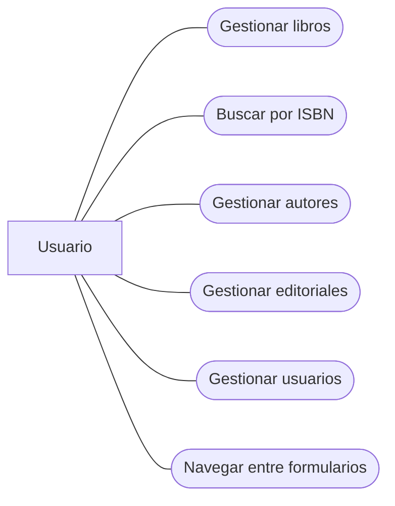
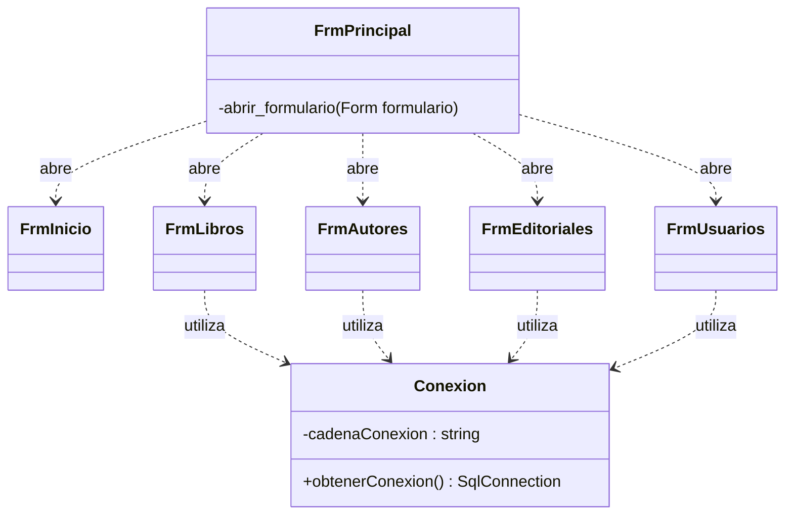
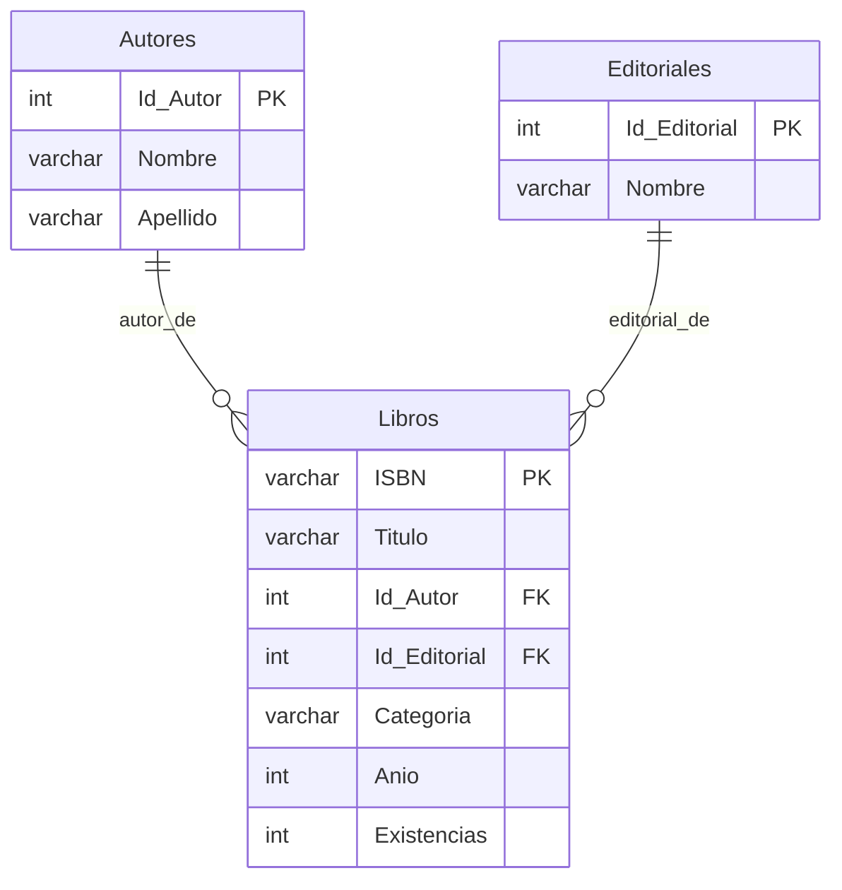
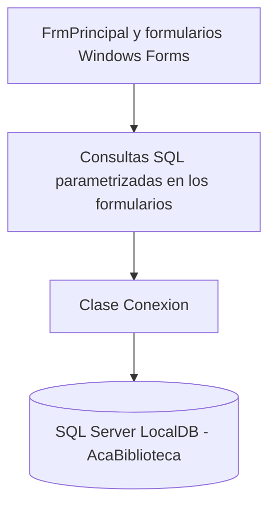

# Sistema de Gestión de Biblioteca — AcaBiblioteca

## Portada

**CORPORACIÓN UNIFICADA NACIONAL DE EDUCACIÓN SUPERIOR (CUN)**

**Programa:** Ingeniería de Sistemas  
**Asignatura:** Programación Avanzada  
**Grupo:** 54465  
**Trabajo:** Actividad de Construcción Aplicada (ACA) — Sistema de Gestión de Biblioteca  
**Estudiante:** Cesar Augusto Albino Vargas  
**Docente:** Veronica Castro  
**Año:** 2026

<!-- PENDIENTE: Confirmar ciudad, fecha exacta de entrega y tildes/nombres oficiales tal como figuran en la plataforma académica. -->

---

## Tabla de contenido

1. [Introducción](#1-introducción)
2. [Objetivos](#2-objetivos)
3. [Planteamiento del problema y alcance](#3-planteamiento-del-problema-y-alcance)
4. [Análisis de requerimientos](#4-análisis-de-requerimientos)
5. [Casos de uso](#5-casos-de-uso)
6. [Diseño de clases](#6-diseño-de-clases)
7. [Modelo de datos](#7-modelo-de-datos)
8. [Diccionario de datos](#8-diccionario-de-datos)
9. [Arquitectura e implementación](#9-arquitectura-e-implementación)
10. [Módulos desarrollados](#10-módulos-desarrollados)
11. [Evidencias visuales](#11-evidencias-visuales)
12. [Pruebas funcionales](#12-pruebas-funcionales)
13. [Conclusiones](#13-conclusiones)
14. [Recomendaciones](#14-recomendaciones)
15. [Referencias y anexos](#15-referencias-y-anexos)

---

## 1. Introducción

AcaBiblioteca es una aplicación de escritorio académica para administrar información básica de una biblioteca. Se desarrolló en C# mediante Windows Forms, utilizando Visual Studio 2026 y SQL Server LocalDB como sistema de almacenamiento. La interfaz permite gestionar libros, autores, editoriales y usuarios mediante operaciones de creación, consulta, actualización y eliminación (CRUD).

El proyecto integra formularios gráficos, programación orientada a objetos, eventos, validaciones, consultas SQL parametrizadas y conexión a una base de datos relacional. Su documentación se limita a las funciones desarrolladas y a los resultados efectivamente observados.

## 2. Objetivos

### 2.1 Objetivo general

Desarrollar una aplicación de escritorio para la gestión básica de una biblioteca mediante C#, Windows Forms y SQL Server LocalDB, aplicando operaciones CRUD y conceptos de programación avanzada.

### 2.2 Objetivos específicos

- Construir una interfaz principal para navegar entre los formularios.
- Implementar la gestión de libros, autores, editoriales y usuarios.
- Permitir la búsqueda de libros mediante ISBN.
- Relacionar libros con autores y editoriales existentes.
- Validar datos obligatorios y presentar mensajes al usuario.
- Centralizar la creación de conexiones a la base de datos.
- Comprobar el funcionamiento mediante pruebas manuales.
- Gestionar versiones del código con Git y GitHub.

## 3. Planteamiento del problema y alcance

### 3.1 Problema

La administración de registros bibliográficos requiere organizar datos y facilitar su consulta y modificación. El acceso directo a las tablas mediante instrucciones SQL no constituye una interfaz adecuada para un usuario general. Como ejercicio académico, se propone una aplicación que centralice las operaciones básicas de mantenimiento de información.

### 3.2 Justificación

El desarrollo permite aplicar conocimientos de interfaces gráficas, eventos, programación orientada a objetos, persistencia relacional y control de errores. La base de datos facilita el almacenamiento estructurado y los formularios proporcionan una interacción más sencilla con la información.

### 3.3 Alcance implementado

- **Libros:** registro, listado, búsqueda por ISBN, edición y eliminación; selección de autor y editorial.
- **Autores:** registro, listado, edición y eliminación.
- **Editoriales:** formulario y código CRUD desarrollados; pruebas funcionales con base de datos aún por registrar.
- **Usuarios:** registro, listado, edición y eliminación.
- **Navegación:** menú principal y apertura de formularios en el panel central.

La aplicación es un prototipo académico, no un sistema desplegado en una biblioteca real. No se atribuyen funcionalidades de autenticación, multas, reservas ni exportaciones que no hayan sido desarrolladas.

<!-- PENDIENTE DESPUÉS DEL JUEVES: Revisar las indicaciones de la docente sobre FrmPrestamos y FrmReportes. Incorporar aquí únicamente las funciones que se implementen y prueben. -->

## 4. Análisis de requerimientos

### 4.1 Actor

**Usuario de la aplicación:** persona que utiliza el menú y los formularios para administrar los registros. No se ha implementado autenticación ni separación de permisos por roles.

### 4.2 Requerimientos funcionales

| Código | Requerimiento | Descripción |
|---|---|---|
| RF01 | Gestión de libros | Registrar, consultar, editar y eliminar libros. |
| RF02 | Búsqueda por ISBN | Localizar libros a partir del ISBN ingresado. |
| RF03 | Gestión de autores | Registrar, consultar, editar y eliminar autores. |
| RF04 | Gestión de editoriales | Disponer de operaciones CRUD para editoriales; pruebas pendientes. |
| RF05 | Gestión de usuarios | Registrar, consultar, editar y eliminar usuarios. |
| RF06 | Visualización | Mostrar registros mediante `DataGridView`. |
| RF07 | Validación | Comprobar campos obligatorios antes de operaciones de escritura. |
| RF08 | Selección | Recuperar datos de registros seleccionados para su edición. |
| RF09 | Confirmación | Solicitar confirmación antes de eliminar. |
| RF10 | Navegación | Abrir los formularios desde el menú principal. |
| RF11 | Relaciones | Seleccionar autor y editorial al registrar libros. |
| RF12 | Persistencia | Consultar y modificar datos en SQL Server LocalDB. |

### 4.3 Requerimientos no funcionales

| Código | Requerimiento | Descripción |
|---|---|---|
| RNF01 | Plataforma | Aplicación de escritorio para Windows. |
| RNF02 | Tecnologías | C#, Windows Forms y Visual Studio 2026. |
| RNF03 | Almacenamiento | Base de datos SQL Server LocalDB. |
| RNF04 | Acceso a datos | Biblioteca `Microsoft.Data.SqlClient`. |
| RNF05 | Usabilidad | Formularios con etiquetas, botones y tablas. |
| RNF06 | Integridad | Claves primarias y foráneas en la base de datos. |
| RNF07 | Seguridad de consultas | Parámetros SQL para valores suministrados por el usuario. |
| RNF08 | Organización | Formularios y clase reutilizable de conexión. |
| RNF09 | Control de versiones | Repositorio Git y GitHub. |

### 4.4 Reglas aplicadas

- El ISBN identifica los registros de libros.
- Los libros se relacionan con autores y editoriales registrados.
- Los formularios validan campos obligatorios antes de guardar o editar.
- La eliminación solicita confirmación y está sujeta a las restricciones de integridad referencial.
- Los cambios realizados correctamente se reflejan en las tablas de consulta.

## 5. Casos de uso

### 5.1 Diagrama funcional simplificado

### 5.2 Descripción

| Código | Caso de uso | Acción principal | Resultado esperado |
|---|---|---|---|
| CU01 | Registrar libro | Completar datos y seleccionar Guardar. | Nuevo libro almacenado. |
| CU02 | Buscar libro | Ingresar ISBN y seleccionar Buscar. | Registro correspondiente consultado. |
| CU03 | Editar libro | Seleccionar registro, modificar datos y editar. | Información actualizada. |
| CU04 | Eliminar libro | Seleccionar registro y confirmar. | Eliminación permitida por las relaciones de datos. |
| CU05 | Gestionar autores | Registrar, consultar, editar o eliminar. | Registros de autores actualizados. |
| CU06 | Gestionar editoriales | Registrar, consultar, editar o eliminar. | Funciones desarrolladas; prueba pendiente. |
| CU07 | Gestionar usuarios | Registrar, consultar, editar o eliminar. | Registros de usuarios actualizados. |
| CU08 | Navegar | Elegir opción del menú principal. | Formulario abierto en el área central. |

### 5.3 Ejemplo de flujo: registrar un libro

1. El usuario abre **Libros**.
2. Ingresa ISBN, título y demás datos solicitados.
3. Selecciona autor y editorial.
4. Presiona **Guardar**.
5. La aplicación valida la información, ejecuta la consulta parametrizada y actualiza el listado cuando la operación se completa.

<!-- PENDIENTE DESPUÉS DEL JUEVES: Añadir casos de uso de Préstamos y Reportes solo si se implementan. -->

## 6. Diseño de clases

### 6.1 Clases principales

| Clase | Responsabilidad |
|---|---|
| `FrmPrincipal` | Presentar menú y cargar formularios en `PnlContenido`. |
| `FrmInicio` | Mostrar la pantalla inicial. |
| `FrmLibros` | Gestionar libros y búsqueda por ISBN. |
| `FrmAutores` | Gestionar autores. |
| `FrmEditoriales` | Gestionar editoriales. |
| `FrmUsuarios` | Gestionar usuarios. |
| `Conexion` | Crear conexiones a SQL Server LocalDB mediante `obtenerConexion()`. |

### 6.2 Diagrama de dependencias de clases

El diagrama refleja las clases y dependencias conocidas, sin atribuir al proyecto controladores o repositorios independientes que no se hayan desarrollado.

<!-- PENDIENTE DESPUÉS DEL JUEVES: Incorporar métodos reales de FrmPrestamos y FrmReportes si se desarrollan; verificar nombres exactos de eventos y métodos en el código final. -->

## 7. Modelo de datos

### 7.1 Tablas

La base de datos académica `AcaBiblioteca` contiene cinco tablas: `Autores`, `Editoriales`, `Libros`, `Usuarios` y `Prestamos`. La existencia de la última tabla no implica que el módulo gráfico de préstamos esté terminado.

### 7.2 Diagrama de relaciones verificadas en los módulos desarrollados

La tabla `Usuarios` se documenta en el diccionario de datos. No se dibujan todavía relaciones ni campos de `Prestamos` que no se hayan contrastado con su definición real.

<!-- PENDIENTE DESPUÉS DEL JUEVES: Consultar el esquema SQL real de Prestamos (columnas, tipos, PK, FK y relaciones) y ampliar el diagrama ER. -->

## 8. Diccionario de datos

Los nombres siguientes se basan en los campos utilizados y verificados durante el desarrollo. Los tipos exactos, longitudes, restricciones `NULL` y valores predeterminados deben cotejarse con el script SQL definitivo antes de la entrega.

### 8.1 Autores

| Campo | Función |
|---|---|
| `Id_Autor` | Identificador principal del autor. |
| `Nombre` | Nombre del autor. |
| `Apellido` | Apellido del autor. |

### 8.2 Editoriales

| Campo | Función |
|---|---|
| `Id_Editorial` | Identificador principal de la editorial. |
| `Nombre` | Nombre de la editorial. |

### 8.3 Libros

| Campo | Función |
|---|---|
| `ISBN` | Identificador del libro. |
| `Titulo` | Título del libro. |
| `Id_Autor` | Referencia al autor. |
| `Id_Editorial` | Referencia a la editorial. |
| `Categoria` | Categoría del libro. |
| `Anio` | Año registrado. |
| `Existencias` | Cantidad de ejemplares registrada. |

### 8.4 Usuarios

| Campo | Función |
|---|---|
| `Id_Usuario` | Identificador principal del usuario. |
| `Nombre` | Nombre del usuario. |
| `Apellido` | Apellido del usuario. |
| `Documento` | Documento de identificación. |
| `Telefono1` | Teléfono almacenado; se muestra como `Telefono` mediante alias SQL. |
| `Correo` | Correo electrónico. |

<!-- PENDIENTE DESPUÉS DEL JUEVES: Agregar diccionario de Prestamos con columnas y tipos obtenidos de SQL Server, sin suposiciones. -->

## 9. Arquitectura e implementación

### 9.1 Organización

La aplicación utiliza formularios Windows Forms para la presentación y los eventos de interacción. Las operaciones SQL de los formularios emplean la clase `Conexion` del espacio de nombres `AcaBiblioteca.Datos`, que proporciona conexiones mediante el método `obtenerConexion()`. El motor de almacenamiento es SQL Server LocalDB.

No se presenta como una arquitectura estricta de tres capas: la lógica de eventos y varias consultas SQL están implementadas dentro de los formularios.

### 9.2 Herramientas

- C# y Windows Forms.
- Visual Studio 2026.
- SQL Server LocalDB.
- `Microsoft.Data.SqlClient`.
- Visual Studio Code para la documentación Markdown.
- Git y GitHub para control de versiones.

### 9.3 Control de versiones

El proyecto se administra en un repositorio GitHub y se sincroniza entre computadores mediante GitHub Desktop. Los cambios se guardan con **Commit** y se publican con **Push**; en el otro equipo se recuperan con **Fetch/Pull** antes de continuar el trabajo.

## 10. Módulos desarrollados

### 10.1 Libros — `FrmLibros`

Dispone de controles para ISBN, título, autor, editorial, categoría, año y existencias. Incluye consulta tabular, búsqueda por ISBN y operaciones CRUD. La selección de autor y editorial se realiza mediante listas desplegables vinculadas a las tablas correspondientes.

### 10.2 Autores — `FrmAutores`

Permite listar, registrar, editar y eliminar autores. Utiliza los campos Nombre y Apellido, una tabla `DataGridView` y botones para las operaciones principales.

### 10.3 Editoriales — `FrmEditoriales`

Permite trabajar con el nombre de la editorial y contiene el código de consulta, registro, edición y eliminación. La prueba completa contra la base de datos aún debe registrarse.

### 10.4 Usuarios — `FrmUsuarios`

Permite registrar, consultar, editar y eliminar usuarios. Incluye nombre, apellido, documento, teléfono y correo. La columna de base de datos `Telefono1` se presenta como `Telefono` en la consulta utilizada por el formulario.

### 10.5 Menú principal — `FrmPrincipal`

Presenta las opciones de navegación y carga los formularios dentro del panel central. `FrmInicio` constituye la pantalla de entrada; no se documentan indicadores estadísticos que todavía no se hayan implementado.

<!-- PENDIENTE DESPUÉS DEL JUEVES: Incorporar aquí las descripciones de FrmPrestamos y FrmReportes solo después de programarlos y probarlos. -->

## 11. Evidencias visuales

Se deben insertar capturas obtenidas de la aplicación en ejecución, preferiblemente con registros de prueba y sin exponer información sensible. Las rutas relativas se actualizarán cuando las imágenes se agreguen al repositorio.

<!-- PENDIENTE: Guardar captura del menú principal y colocar aquí:  -->
<!-- PENDIENTE: Guardar captura de FrmLibros y colocar aquí:  -->
<!-- PENDIENTE: Guardar captura de FrmAutores y colocar aquí:  -->
<!-- PENDIENTE: Guardar captura de FrmEditoriales y colocar aquí:  -->
<!-- PENDIENTE: Guardar captura de FrmUsuarios y colocar aquí:  -->
<!-- PENDIENTE DESPUÉS DEL JUEVES: Agregar capturas de préstamos y reportes si se implementan. -->

## 12. Pruebas funcionales

Las pruebas se realizaron manualmente en un equipo con SQL Server LocalDB, utilizando registros de prueba. El desarrollo de algunos formularios se adelantó en un segundo equipo sin base de datos, por lo que compilar correctamente no se consideró equivalente a una prueba funcional.

| Módulo | Consulta | Guardar | Editar | Eliminar | Observación |
|---|---|---|---|---|---|
| Libros | Comprobado | Comprobado | Comprobado | Comprobado | También se verificó búsqueda por ISBN. |
| Autores | Comprobado | Comprobado | Comprobado | Comprobado | Pruebas con registro temporal creado, editado y eliminado. |
| Editoriales | Pendiente | Pendiente | Pendiente | Pendiente | Código implementado; falta registrar pruebas en PC con SQL Server. |
| Usuarios | Comprobado | Comprobado | Comprobado | Comprobado | Se verificó registro y corrección de nombre de columna telefónica. |

**Criterio de aceptación:** la operación se considera comprobada cuando la aplicación muestra el resultado esperado y los datos reflejan el cambio correspondiente. Los resultados pendientes no se presentan como exitosos.

<!-- PENDIENTE: Ejecutar y registrar las cuatro pruebas de Editoriales; añadir fecha y capturas si se requieren. -->
<!-- PENDIENTE: Incorporar pruebas de validaciones, restricciones de claves foráneas y mensajes de error únicamente cuando se ejecuten. -->
<!-- PENDIENTE DESPUÉS DEL JUEVES: Agregar pruebas de Préstamos y Reportes si se implementan. -->

## 13. Conclusiones

El desarrollo de AcaBiblioteca permitió integrar interfaces Windows Forms con una base de datos SQL Server LocalDB y aplicar operaciones CRUD en varios módulos relacionados. Las pruebas realizadas en Libros, Autores y Usuarios evidencian la ejecución de operaciones de consulta y modificación de registros desde la interfaz gráfica.

La experiencia también mostró la importancia de comprobar los nombres reales de las columnas de SQL Server y de distinguir entre la compilación del código y su funcionamiento con una base de datos disponible. El control de versiones facilitó continuar el proyecto desde diferentes computadores.

## 14. Recomendaciones

- Completar las pruebas funcionales pendientes de Editoriales.
- Revisar el diseño de los botones y la presentación de los formularios para mejorar su legibilidad.
- Mantener las consultas parametrizadas y las validaciones de campos.
- Verificar los tipos y restricciones de las columnas contra el script SQL final.
- Conservar versiones del proyecto mediante commits descriptivos en GitHub.
- Actualizar esta documentación cuando se implementen nuevas funcionalidades.

## 15. Referencias y anexos

### 15.1 Referencias técnicas

- Microsoft Learn. Documentación de C# y Windows Forms: <https://learn.microsoft.com/dotnet/desktop/winforms/>
- Microsoft Learn. Documentación de SQL Server: <https://learn.microsoft.com/sql/sql-server/>
- Microsoft Learn. Biblioteca `Microsoft.Data.SqlClient`: <https://learn.microsoft.com/sql/connect/ado-net/microsoft-ado-net-sql-server>
- GitHub Docs. Documentación de GitHub: <https://docs.github.com/>

### 15.2 Repositorio del proyecto

Repositorio GitHub: <https://github.com/cesaralbino-hub/AcaBiblioteca>  
**Nota:** el repositorio es privado; su consulta requiere autorización.

### 15.3 Anexos pendientes

<!-- PENDIENTE: Agregar script SQL final de creación de tablas y relaciones, o indicar su ruta dentro del repositorio. -->
<!-- PENDIENTE: Agregar capturas de pruebas y evidencia de commits de GitHub, si la docente las solicita. -->
<!-- PENDIENTE: Revisar que las referencias técnicas utilizadas correspondan a fuentes efectivamente consultadas y añadir fecha de consulta si se requiere. -->

---

<!-- CONTROL DE EDICIÓN (NO VISIBLE EN VISTA PREVIA):
1. Confirmar datos de portada y fecha de entrega.
2. Verificar el esquema completo de SQL Server y actualizar tipos/relaciones.
3. Completar pruebas y evidencias de Editoriales.
4. Después de las indicaciones del jueves, implementar/documentar Préstamos y Reportes si corresponde.
5. Incorporar capturas y anexos reales.
6. Revisar documento y eliminar estos comentarios antes de la entrega definitiva, una vez resueltos.
-->
