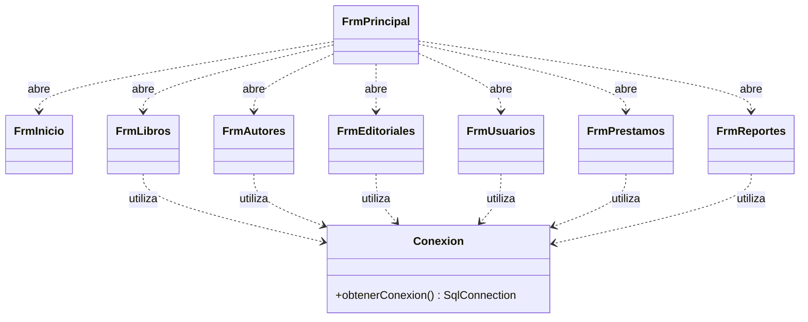
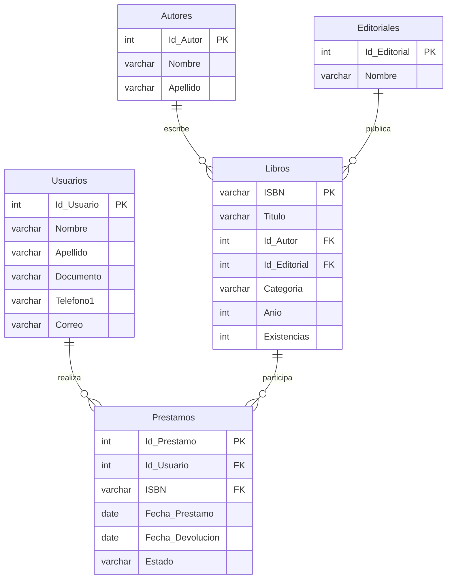
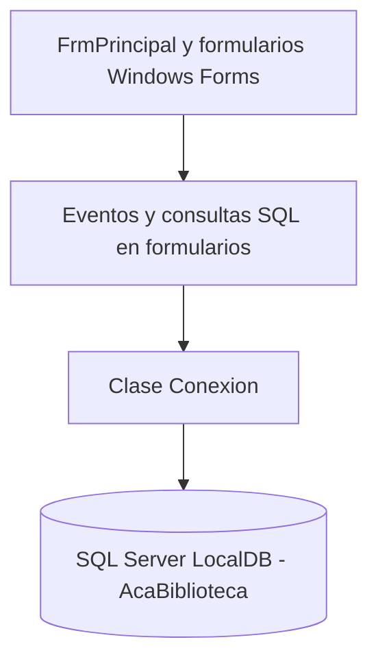

# Sistema de Gestión de Biblioteca — AcaBiblioteca

## Portada

**CORPORACIÓN UNIFICADA NACIONAL DE EDUCACIÓN SUPERIOR (CUN)**

**Programa:** Ingeniería de Sistemas  
**Asignatura:** Programación Avanzada  
**Grupo:** 54465  
**Trabajo:** Actividad de Construcción Aplicada (ACA) — Sistema de Gestión de Biblioteca  
**Estudiante:** César Augusto Albino Vargas  
**Docente:** Verónica Castro  
**Año:** 2026

<!-- PENDIENTE: Confirmar ciudad, fecha exacta de entrega y escritura oficial de nombres en la plataforma académica. -->

---

## Tabla de contenido

1. [Introducción](#1-introducción)
2. [Objetivos](#2-objetivos)
3. [Planteamiento del problema y alcance](#3-planteamiento-del-problema-y-alcance)
4. [Análisis de requerimientos](#4-análisis-de-requerimientos)
5. [Casos de uso](#5-casos-de-uso)
6. [Diseño de clases](#6-diseño-de-clases)
7. [Modelo de datos](#7-modelo-de-datos)
8. [Diccionario de datos](#8-diccionario-de-datos)
9. [Arquitectura e implementación](#9-arquitectura-e-implementación)
10. [Módulos desarrollados](#10-módulos-desarrollados)
11. [Evidencias visuales](#11-evidencias-visuales)
12. [Pruebas funcionales](#12-pruebas-funcionales)
13. [Conclusiones](#13-conclusiones)
14. [Recomendaciones](#14-recomendaciones)
15. [Referencias y anexos](#15-referencias-y-anexos)

---

## 1. Introducción

AcaBiblioteca es una aplicación de escritorio académica para administrar información básica de una biblioteca. Se desarrolló en C# mediante Windows Forms, utilizando Visual Studio 2026 y SQL Server LocalDB como sistema de almacenamiento. La interfaz permite gestionar libros, autores, editoriales y usuarios mediante operaciones de creación, consulta, actualización y eliminación (CRUD). También incluye registro y devolución de préstamos, actualización de existencias y consultas de reportes.

El proyecto integra formularios gráficos, programación orientada a objetos, eventos, validaciones, consultas SQL parametrizadas y conexión a una base de datos relacional. Su documentación se limita a las funciones desarrolladas y a los resultados efectivamente observados.

## 2. Objetivos

### 2.1 Objetivo general

Desarrollar una aplicación de escritorio para la gestión básica de una biblioteca mediante C#, Windows Forms y SQL Server LocalDB, aplicando operaciones CRUD y conceptos de programación avanzada.

### 2.2 Objetivos específicos

- Construir una interfaz principal para navegar entre los formularios.
- Implementar la gestión de libros, autores, editoriales y usuarios.
- Permitir la búsqueda de libros mediante ISBN.
- Relacionar libros con autores y editoriales existentes.
- Validar datos obligatorios y presentar mensajes al usuario.
- Centralizar la creación de conexiones a la base de datos.
- Registrar préstamos y devoluciones, manteniendo las existencias de libros.
- Generar consultas de préstamos activos, préstamos devueltos e inventario de libros.
- Comprobar el funcionamiento mediante pruebas manuales.
- Gestionar versiones del código con Git y GitHub.

## 3. Planteamiento del problema y alcance

### 3.1 Problema

La administración de registros bibliográficos y de circulación de libros requiere organizar información, mantener las existencias actualizadas y facilitar las consultas. La interacción directa con tablas SQL no constituye una interfaz adecuada para el usuario general. El proyecto propone un sistema académico de escritorio que centraliza esas operaciones.

### 3.2 Justificación

El desarrollo permite aplicar interfaces gráficas, programación orientada a objetos, manejo de eventos, persistencia relacional, consultas parametrizadas, validaciones y control de errores.

### 3.3 Alcance implementado

- **Libros:** registro, consulta, búsqueda por ISBN, edición y eliminación, con selección de autor y editorial.
- **Autores, editoriales y usuarios:** formularios de consulta y mantenimiento CRUD.
- **Préstamos:** selección de usuario y libro, registro de préstamo, consulta, edición y eliminación; manejo de fecha de devolución opcional y estado del préstamo.
- **Devoluciones:** actualización de un préstamo a estado `Devuelto` y restitución de existencias del libro; se comprobó mediante SQL en una prueba.
- **Reportes:** préstamos activos, préstamos devueltos e inventario de libros; generación y limpieza de resultados.
- **Navegación:** menú principal y apertura de formularios en el panel central.

El sistema es un prototipo académico. No incluye autenticación, reservas, multas ni exportación de reportes.

<!-- PENDIENTE: Verificar que las pruebas de eliminación de préstamos y el comportamiento de existencias en todos los escenarios estén registradas antes de atribuirles cobertura completa. -->

## 4. Análisis de requerimientos

### 4.1 Actor

**Operador de la biblioteca:** utiliza el menú y los formularios para administrar registros, préstamos y consultas. No se implementaron cuentas de acceso ni permisos diferenciados.

### 4.2 Requerimientos funcionales

| Código | Requerimiento | Descripción |
|---|---|---|
| RF01 | Gestionar libros | Registrar, consultar, buscar por ISBN, editar y eliminar libros. |
| RF02 | Gestionar autores | Registrar, consultar, editar y eliminar autores. |
| RF03 | Gestionar editoriales | Registrar, consultar, editar y eliminar editoriales. |
| RF04 | Gestionar usuarios | Registrar, consultar, editar y eliminar usuarios. |
| RF05 | Registrar préstamos | Asociar un usuario con un libro y registrar la fecha del préstamo. |
| RF06 | Gestionar devoluciones | Registrar fecha de devolución, estado `Devuelto` y actualizar existencias. |
| RF07 | Consultar préstamos | Visualizar préstamos y sus estados en una tabla. |
| RF08 | Generar reportes | Consultar préstamos activos, préstamos devueltos e inventario. |
| RF09 | Validar información | Comprobar campos requeridos y fechas según las reglas implementadas. |
| RF10 | Navegar | Acceder a los formularios desde el menú principal. |
| RF11 | Mantener relaciones | Relacionar libros con autores/editoriales y préstamos con usuarios/libros. |
| RF12 | Persistir datos | Ejecutar consultas y modificaciones en SQL Server LocalDB. |

### 4.3 Requerimientos no funcionales

| Código | Requerimiento | Descripción |
|---|---|---|
| RNF01 | Plataforma | Aplicación de escritorio para Windows. |
| RNF02 | Tecnologías | C#, Windows Forms y Visual Studio 2026. |
| RNF03 | Almacenamiento | SQL Server LocalDB. |
| RNF04 | Acceso a datos | `Microsoft.Data.SqlClient` y clase `Conexion`. |
| RNF05 | Usabilidad | Etiquetas, botones, listas desplegables y `DataGridView`. |
| RNF06 | Integridad | Claves primarias, foráneas y restricciones relacionales. |
| RNF07 | Consultas seguras | Uso de parámetros SQL para valores ingresados. |
| RNF08 | Control de versiones | Git, GitHub y GitHub Desktop. |

### 4.4 Reglas de negocio observadas

- El ISBN identifica cada libro.
- Los libros se asocian con autores y editoriales.
- Un préstamo se vincula con un usuario y un ISBN.
- La fecha de devolución admite `NULL` para préstamos activos.
- Los estados utilizados son `Prestado` y `Devuelto`.
- Se comprobó que registrar un préstamo reduce las existencias y registrar su devolución las restituye.
- Las operaciones CRUD utilizan los controles y validaciones del formulario.

### 4.5 Diagrama de referencia de la docente

*Figura 1. Análisis de requerimientos suministrado por la docente como material de apoyo.*

**Aclaración:** la figura describe una propuesta más amplia e incluye categorías independientes, multas y otros requisitos no implementados. La tabla de requerimientos anterior corresponde al alcance real de AcaBiblioteca.

## 5. Casos de uso

### 5.1 Diagrama de referencia

*Figura 2. Diagrama de casos de uso suministrado por la docente.*

**Alcance:** los casos de multas, cálculo de retrasos, categorías independientes y otros procesos de la figura no se atribuyen a la aplicación implementada.

### 5.2 Casos de uso del sistema desarrollado

| Código | Caso de uso | Resultado esperado |
|---|---|---|
| CU01 | Registrar libro | Libro almacenado y visible en el listado. |
| CU02 | Buscar libro por ISBN | Se muestra el libro correspondiente. |
| CU03 | Editar o eliminar libro | Se modifica o elimina si las restricciones lo permiten. |
| CU04 | Gestionar autores | Se realizan operaciones de mantenimiento. |
| CU05 | Gestionar editoriales | Se realizan operaciones de mantenimiento. |
| CU06 | Gestionar usuarios | Se realizan operaciones de mantenimiento. |
| CU07 | Registrar préstamo | Se crea el préstamo y se actualizan existencias. |
| CU08 | Registrar devolución | El préstamo queda `Devuelto` y se restituye una existencia. |
| CU09 | Consultar préstamos activos | Se muestran préstamos con estado `Prestado`. |
| CU10 | Consultar préstamos devueltos | Se muestran préstamos con estado `Devuelto`. |
| CU11 | Consultar inventario | Se muestran libros, autores, editoriales y existencias. |
| CU12 | Limpiar reporte | Se vacía la consulta visualizada. |

### 5.3 Flujo resumido de préstamo y devolución

1. El operador abre **Préstamos** y selecciona un usuario y un libro.
2. Indica la fecha del préstamo y deja sin marcar la fecha de devolución cuando el libro se entrega al usuario.
3. Presiona **Guardar**; la aplicación registra el préstamo y descuenta una existencia.
4. Al devolver el libro, selecciona el préstamo, marca la fecha de devolución y presiona **Editar**.
5. La aplicación actualiza el estado a `Devuelto` y restituye la existencia; este resultado se verificó en la base de datos.

## 6. Diseño de clases

### 6.1 Diagrama de referencia proporcionado por la docente

*Figura 3. Diagrama de clases suministrado por la docente como guía académica.*

**Diferencias:** la figura incluye clases `Categoria`, `DetallePrestamo` y `Devolucion`, así como métodos para multas. Esas clases no forman parte de la implementación actual, que trabaja con cinco tablas y formularios Windows Forms.

### 6.2 Clases principales implementadas

| Clase | Responsabilidad |
|---|---|
| `FrmPrincipal` | Menú principal y apertura de formularios en `PnlContenido`. |
| `FrmInicio` | Pantalla inicial. |
| `FrmLibros` | CRUD de libros y búsqueda por ISBN. |
| `FrmAutores` | CRUD de autores. |
| `FrmEditoriales` | CRUD de editoriales. |
| `FrmUsuarios` | CRUD de usuarios. |
| `FrmPrestamos` | Registro, edición, eliminación y consulta de préstamos y devoluciones. |
| `FrmReportes` | Consultas de préstamos activos, devueltos e inventario. |
| `Conexion` | Obtención de conexión SQL mediante `obtenerConexion()`. |

### 6.3 Dependencias de la implementación

<!-- PENDIENTE: Revisar los nombres exactos de métodos y eventos en el código fuente antes de ampliar el diagrama UML con firmas. -->

## 7. Modelo de datos

### 7.1 Base de datos implementada

La base de datos `AcaBiblioteca` en SQL Server LocalDB contiene cinco tablas: `Autores`, `Editoriales`, `Libros`, `Usuarios` y `Prestamos`. La categoría se almacena en el campo `Categoria` de `Libros`. La devolución se registra en `Prestamos` mediante fecha y estado, sin tabla independiente.

### 7.2 Diagrama entidad-relación de la implementación

**Nota:** las relaciones representan el diseño relacional utilizado en el sistema. La verificación final de nombres, longitudes y restricciones debe realizarse contra el script SQL entregado.

<!-- PENDIENTE: Adjuntar captura del diagrama de base de datos o script SQL definitivo si la docente lo solicita. -->

## 8. Diccionario de datos

### 8.1 Diccionario de referencia de la docente

*Figura 4. Diccionario de datos proporcionado por la docente.*

**Aclaración:** contiene siete entidades y campos diferentes a nuestra base de datos; no representa el esquema implementado. El siguiente diccionario sí utiliza los nombres de las cinco tablas reales.

### 8.2 Tabla `Autores`

| Campo | Descripción |
|---|---|
| `Id_Autor` | Identificador principal del autor. |
| `Nombre` | Nombre. |
| `Apellido` | Apellido. |

### 8.3 Tabla `Editoriales`

| Campo | Descripción |
|---|---|
| `Id_Editorial` | Identificador principal de la editorial. |
| `Nombre` | Nombre de la editorial. |

### 8.4 Tabla `Libros`

| Campo | Descripción |
|---|---|
| `ISBN` | Identificador del libro. |
| `Titulo` | Título. |
| `Id_Autor` | Referencia al autor. |
| `Id_Editorial` | Referencia a la editorial. |
| `Categoria` | Categoría o género. |
| `Anio` | Año de publicación registrado. |
| `Existencias` | Cantidad de ejemplares disponibles. |

### 8.5 Tabla `Usuarios`

| Campo | Descripción |
|---|---|
| `Id_Usuario` | Identificador principal. |
| `Nombre` | Nombre. |
| `Apellido` | Apellido. |
| `Documento` | Documento de identificación. |
| `Telefono1` | Teléfono; el formulario puede mostrarlo con alias `Telefono`. |
| `Correo` | Correo electrónico. |

### 8.6 Tabla `Prestamos`

| Campo | Tipo SQL | Permite `NULL` | Descripción |
|---|---|---|---|
| `Id_Prestamo` | `int` | No | Identificador del préstamo. |
| `Id_Usuario` | `int` | No | Usuario asociado. |
| `ISBN` | `varchar` | No | Libro prestado. |
| `Fecha_Prestamo` | `date` | No | Fecha del préstamo. |
| `Fecha_Devolucion` | `date` | Sí | Fecha de devolución, opcional mientras está prestado. |
| `Estado` | `varchar` | No | Estado del préstamo (`Prestado` o `Devuelto`). |

Los tipos y la nulabilidad de `Prestamos` se comprobaron mediante una consulta al esquema SQL compartida durante el desarrollo. Las longitudes de los campos `varchar` y los tipos exactos de las demás tablas deben verificarse con el script definitivo.

<!-- PENDIENTE: Completar tipo SQL, longitud, nulabilidad y restricciones de todas las columnas usando el script final. -->

## 9. Arquitectura e implementación

### 9.1 Arquitectura de referencia de la docente

*Figura 5. Arquitectura general suministrada por la docente.*

La imagen describe una organización por capas propuesta para un sistema de biblioteca. **No debe interpretarse como prueba de que el proyecto implementa controladores, repositorios o un servidor remoto de base de datos.**

### 9.2 Arquitectura utilizada en AcaBiblioteca

La aplicación utiliza formularios Windows Forms que manejan eventos y ejecutan consultas SQL parametrizadas. La clase `Conexion`, ubicada en el proyecto, centraliza la creación de conexiones mediante `obtenerConexion()`. El almacenamiento utiliza SQL Server LocalDB.

No se presenta como arquitectura estricta de tres capas, porque parte de la lógica de negocio y del acceso a datos se encuentra en los formularios.

### 9.3 Herramientas

- Visual Studio 2026, C# y Windows Forms.
- SQL Server LocalDB y `Microsoft.Data.SqlClient`.
- Visual Studio Code para editar Markdown.
- Git, GitHub y GitHub Desktop para versionamiento.

### 9.4 Control de versiones

El proyecto se mantiene en un repositorio GitHub y se sincroniza entre computadores mediante **Commit**, **Push**, **Fetch** y **Pull** en GitHub Desktop.

## 10. Módulos desarrollados

### 10.1 Libros — `FrmLibros`

Formulario con ISBN, título, autor, editorial, categoría, año y existencias. Permite consulta, búsqueda por ISBN y operaciones CRUD. Los autores y editoriales se seleccionan desde listas desplegables.

### 10.2 Autores — `FrmAutores`

Formulario para consultar, registrar, editar y eliminar autores mediante Nombre, Apellido y tabla `DataGridView`.

### 10.3 Editoriales — `FrmEditoriales`

Formulario de consulta y mantenimiento de editoriales. Su listado fue observado en ejecución con datos provenientes de la base de datos.

### 10.4 Usuarios — `FrmUsuarios`

Formulario CRUD de usuarios con nombre, apellido, documento, teléfono y correo. La columna `Telefono1` se presenta como `Telefono` mediante alias en la consulta del formulario.

### 10.5 Préstamos y devoluciones — `FrmPrestamos`

Incluye listas desplegables de usuario y libro, fecha de préstamo y fecha de devolución opcional, botones Nuevo, Guardar, Editar, Eliminar y Cancelar, y una tabla con identificador, usuario, ISBN, fechas y estado. Se probó el registro de un préstamo y su posterior devolución, verificando los cambios en `Prestamos` y en las existencias del libro.

### 10.6 Reportes — `FrmReportes`

Permite seleccionar el tipo de reporte, **Generar** resultados y **Limpiar** la tabla. Se visualizaron correctamente tres consultas:

1. **Préstamos activos:** registros en estado `Prestado`, con nombre del usuario y título del libro.
2. **Préstamos devueltos:** registros en estado `Devuelto`, con fechas y datos asociados.
3. **Inventario de libros:** ISBN, título, autor, editorial, categoría, año y existencias.

### 10.7 Menú principal — `FrmPrincipal`

Presenta las opciones Inicio, Libros, Usuarios, Autores, Editoriales, Préstamos, Reportes y Salir; los formularios se abren dentro del panel central.

## 11. Evidencias visuales

Las figuras de la docente incluidas en las secciones 4, 5, 6, 8 y 9 son **material de referencia**, no capturas de la aplicación. Las capturas de la implementación deben agregarse por separado y corresponder al funcionamiento observado.

<!-- PENDIENTE: Guardar capturas propias en la carpeta evidencias/ e insertar enlaces Markdown.

-->

<!-- PENDIENTE: Incorporar evidencia de consulta SQL que muestra disminución y restitución de existencias tras préstamo/devolución. -->

## 12. Pruebas funcionales

Las pruebas se realizaron manualmente en un equipo con SQL Server LocalDB. Se distingue entre compilación correcta, visualización del módulo y prueba completa de cada operación.

| Módulo o función | Resultado documentado | Evidencia observada |
|---|---|---|
| Libros — CRUD | Comprobado | Registro, consulta, edición y eliminación; búsqueda por ISBN. |
| Autores — CRUD | Comprobado | Registro temporal, edición y eliminación. |
| Usuarios — CRUD | Comprobado | Operaciones CRUD y corrección de columna telefónica. |
| Editoriales — consulta | Comprobado | Listado de editoriales cargado desde la base de datos. |
| Editoriales — guardar, editar y eliminar | Pendiente de consolidar | No se dispone aquí de evidencia completa de cada operación. |
| Préstamos — registro | Comprobado | Mensaje de préstamo registrado y registro SQL generado. |
| Préstamos — actualización/devolución | Comprobado | Mensaje de actualización, estado `Devuelto` y fecha registrada en SQL. |
| Existencias — préstamo | Comprobado | Para el libro *1984*, las existencias pasaron de 4 a 3. |
| Existencias — devolución | Comprobado | Para el mismo libro, las existencias regresaron de 3 a 4. |
| Préstamos — eliminación | Pendiente de consolidar | No se incluye aquí una verificación final documentada. |
| Reporte — préstamos activos | Comprobado | Tabla de préstamos en estado `Prestado`. |
| Reporte — préstamos devueltos | Comprobado | Tabla de préstamos en estado `Devuelto`. |
| Reporte — inventario | Comprobado | Tabla con ISBN, título, autor, editorial y existencias. |
| Reportes — limpiar | Comprobado | Se vació la tabla de resultados. |

### 12.1 Caso de prueba: préstamo y devolución de *1984*

1. Antes del préstamo, el libro con ISBN `9780451524935` tenía **4 existencias**.
2. Se registró un préstamo para el usuario con identificador `1` y se verificó el registro `Id_Prestamo = 1002`, con estado `Prestado` y fecha de devolución `NULL`.
3. Tras registrar el préstamo, las existencias quedaron en **3**.
4. Se editó el préstamo para indicar devolución el **5 de noviembre de 2026**; SQL mostró estado `Devuelto`.
5. La consulta posterior mostró **4 existencias**, confirmando la restitución de una unidad.
6. Posteriormente, una consulta de verificación mostró que el préstamo de prueba ya no aparecía; se conserva como evidencia principal la comprobación previa de préstamo y devolución.

### 12.2 Criterio de aceptación

Se considera comprobada una función cuando el resultado es visible en la aplicación y, para las operaciones de escritura, coincide con los datos verificados en SQL Server. La compilación sin errores por sí sola no demuestra el funcionamiento de una operación.

<!-- PENDIENTE: Adjuntar capturas y fechas de cada prueba; completar CRUD de Editoriales y eliminación de préstamos si se requiere documentar esas funciones como comprobadas. -->

## 13. Conclusiones

El desarrollo de AcaBiblioteca permitió aplicar C#, Windows Forms, eventos, consultas SQL y persistencia relacional en una aplicación de escritorio. Se implementaron formularios de mantenimiento para libros, autores, editoriales y usuarios, además de módulos de préstamos y reportes.

Las pruebas de préstamo y devolución mostraron que es posible mantener coherencia entre el estado del préstamo y las existencias del libro. Los reportes permitieron consultar préstamos activos, devoluciones e inventario con información relacionada de distintas tablas.

El proyecto también evidenció la importancia de contrastar los nombres reales de las columnas, verificar las operaciones directamente en la base de datos y utilizar GitHub para mantener sincronizado el código entre computadores. Los diagramas proporcionados por la docente sirvieron como guía conceptual, mientras que la documentación de implementación se ajustó a los componentes realmente desarrollados.

## 14. Recomendaciones

- Completar las evidencias de todas las operaciones CRUD y conservar capturas de las consultas SQL.
- Revisar y registrar escenarios de error, como intentar prestar un libro sin existencias o eliminar registros relacionados.
- Confirmar longitudes, tipos y restricciones de las tablas contra el script SQL definitivo.
- Mantener las consultas parametrizadas, validaciones y mensajes claros.
- Conservar commits descriptivos en GitHub y verificar la sincronización antes de trabajar en otro equipo.
- Si el proyecto se amplía, considerar separar la lógica de negocio y acceso a datos de los formularios, sin atribuir esa separación a la versión actual.

## 15. Referencias y anexos

### 15.1 Referencias técnicas

- Microsoft Learn. Windows Forms: <https://learn.microsoft.com/dotnet/desktop/winforms/>
- Microsoft Learn. SQL Server: <https://learn.microsoft.com/sql/sql-server/>
- Microsoft Learn. `Microsoft.Data.SqlClient`: <https://learn.microsoft.com/sql/connect/ado-net/microsoft-ado-net-sql-server>
- GitHub Docs: <https://docs.github.com/>
- Castro, V. (2026). *Material de apoyo para el Sistema de Gestión de Biblioteca: análisis de requerimientos, casos de uso, diagrama de clases, arquitectura y diccionario de datos* [Material de clase proporcionado por la docente]. Programación Avanzada, CUN.

### 15.2 Repositorio del proyecto

Repositorio GitHub: <https://github.com/cesaralbino-hub/AcaBiblioteca>  
**Nota:** el repositorio es privado; su consulta requiere autorización.

### 15.3 Material gráfico incorporado

Las cinco imágenes de referencia se encuentran en la carpeta `imagenes/`. Su inclusión responde a la orientación de la docente y no significa que todas las entidades, clases y funcionalidades de las figuras se hayan implementado.

### 15.4 Anexos por completar

<!-- PENDIENTE: Adjuntar o enlazar el script SQL final de creación de tablas y relaciones. -->
<!-- PENDIENTE: Incorporar capturas reales de los formularios, reportes y pruebas SQL. -->
<!-- PENDIENTE: Adjuntar evidencia de commits si la docente la solicita. -->
<!-- PENDIENTE: Verificar datos de portada y formato final exigido por la docente. -->

---

<!-- CONTROL DE EDICIÓN: Revisar comentarios PENDIENTE antes de la entrega final. -->

